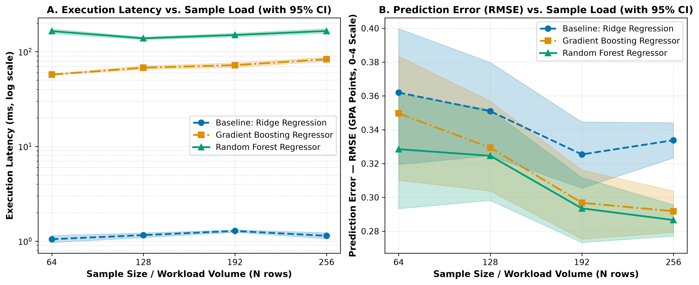
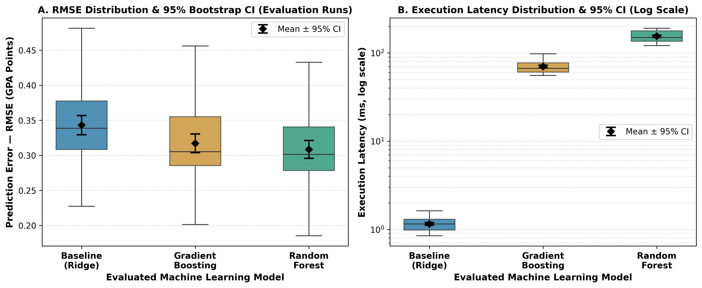

# Fast Dopamine & Academic Performance: Predicting Student GPA Based on Social Media Usage and Psychometric Indicators

**Authors:** Sharap Alislam, Miir Yerassyl  
**Repository:** `https://github.com/EraMiir/fast-dopamine-academic-performance`  
**Course / Assignment:** Task 3 — Research Results, Data Analysis, and Scientific Visualization

---

## 1. Overview & Research Questions

This repository contains the end-to-end benchmarking, statistical aggregation, and scientific visualization pipeline evaluating machine learning models that predict student academic performance (`Last Academic Result (GPA/CGPA)`) from behavioral social media ("fast dopamine") metrics and psychometric indicators ($N = 256$ survey responses).

* **RQ1:** To what extent do non-linear ensemble machine learning models (`RandomForestRegressor`, `GradientBoostingRegressor`) reduce the prediction error ($\text{RMSE}$, $\text{MAE}$) of student GPA compared to a linear baseline (`Ridge Regression`) when incorporating social media distraction and psychometric indicators?
* **RQ2 (exploratory):** Which selected survey factors show monotonic associations with GPA? The current analysis reports pairwise Spearman correlations; it does not estimate interaction effects or adjust associations jointly for study time and attendance.

---

## cleaning dataset

|Variable|How did they respond?|What We Did|
|---|---|---|
|Age|**21 years old**, **dd/mm/1999**|The number was extracted by converting to age (2025 − year)|
|StudyH|**3/4h**, **2 hrs**, **30 mins**|Extracted the time, minutes /60, ranges to average|
|Attend|**85%**, **0.9**, **90**|Converted to a fraction between 0 and 1|
|SM_hours|**less than 2**, **3-4 hours**, **20%**|Same as for StudyH|
|GPA|**4.0 and 5.0 scales**, **letters (A, B+, etc.)**|Letter grades are mapped to fixed 4.0-scale values. Numeric values from 0.0 to 4.0 are kept unchanged. Values above 4.0 and below 4.5 are mapped to 3.0; values from 4.5 to 5.0 are mapped to 4.0. Other unrecognized values are removed. This is an approximate harmonization, not a proportional conversion.|

## 2. Final Repository Directory Structure

```text
fast-dopamine-academic-performance/
├── configs/
│   └── config.yaml
├── data/
│   ├── raw/
│   │   ├── survey.csv
│   │   └── test_run.jsonl
│   ├── processed/
│   │   ├── feature_gpa_correlations.csv
│   │   └── metrics_summary.csv
│   ├── sample/
│   │   └── sample_survey.csv
│   └── cleaned_survey.csv
├── docs/
│   ├── README.md
│   └── domain_model.md
├── notebooks/
│   ├── 01_data_analysis.ipynb
│   ├── data_cleaning.ipynb
│   └── README.md
├── reports/
│   └── figures/
│       ├── fig1_latency_vs_load.pdf
│       ├── fig1_latency_vs_load.png
│       ├── fig2_distribution_boxplot.pdf
│       └── fig2_distribution_boxplot.png
├── src/
│   ├── analyze_relationships.py
│   ├── benchmark.py
│   ├── process_data.py
│   └── visualize.py
├── .gitignore
├── Dockerfile
├── LICENSE
├── README.md
└── requirements.txt
```

## 3. Planned Benchmarks & Metrics Matrix
|Model / Condition|Feature Set|Primary Metric|Secondary Metrics|Guardrail Metrics|
|---|---|---|---|---|
|Baseline: Ridge Regression ($\alpha=1.0$)|Academic + Social Media + Psychometric|RMSE|$MAE$, $R^2$|Latency $\le 2000\text{ ms}$, RAM $\le 512\text{ MB}$|
|Random Forest Regressor|Academic + Social Media + Psychometric|RMSE|$MAE$, $R^2$|Latency $\le 2000\text{ ms}$, RAM $\le 512\text{ MB}$|
|Gradient Boosting Regressor|Academic + Social Media + Psychometric|RMSE|$MAE$, $R^2$|Latency $\le 2000\text{ ms}$, RAM $\le 512\text{ MB}$|

## 4. Domain Model & Formalization

The complete mathematical formalization of the loss functions ($\mathcal{L}_{\text{Ridge}}, \mathcal{L}_{\text{GBR}}$), target metrics ($\text{RMSE}, \text{MAE}$), non-parametric bootstrap 95% confidence intervals, and the C4 Component Telemetry Diagram are documented in docs/domain_model.md.

## 5. Results & Discussion
### 5.1. Summary Benchmark Table ($N = 256$ Full Workload, Cold-Start Warm-up Filtered)

**Historical results — not valid as results of the corrected pipeline.** These figures were produced before Ridge feature standardization was added and before the repaired benchmark was rerun. They are retained only as a record of the previous submission and must not be cited as updated results. The reproducible workflow on branch `fix/scaled-ridge-model-comparison` reruns the benchmark, regenerates the summary and figures, and uploads the outputs as a GitHub Actions artifact.

All metrics are computed strictly on post-warmup evaluation runs ($n = 20$ evaluation repetitions per load level; $240$ total evaluation runs across $N \in \{64, 128, 192, 256\}$, random_seed = 42).

|Model / Method|RMSE Mean ± SD|RMSE Median (p25–p75)|RMSE 95% CI|RMSE p95 / p99|MAE Mean ± SD|Latency Median (p95 / p99)|Error Rate|
|---|---:|---:|---:|---:|---:|---:|---:|
|Baseline: Ridge Regression|0.3338 ± 0.0245|0.3335 (0.3129–0.3500)|[0.3233, 0.3442]|0.3731 / 0.3766|0.2677 ± 0.0206|1.07 ms (1.49 / 1.60 ms)|0.0%|
|Gradient Boosting Regressor|0.2918 ± 0.0278|0.2919 (0.2850–0.3043)|[0.2793, 0.3038]|0.3402 / 0.3425|0.2192 ± 0.0218|80.64 ms (94.74 / 96.93 ms)|0.0%|
|Random Forest Regressor|0.2866 ± 0.0220|0.2926 (0.2735–0.3009)|[0.2771, 0.2956]|0.3153 / 0.3160|0.2221 ± 0.0172|173.45 ms (186.63 / 187.36 ms)|0.0%|

### 5.2. Key Findings & Methodological Notes

1. **Prediction accuracy:** the lowest mean RMSE at sample size 256 is achieved by **Random Forest Regressor** (0.2866 GPA points; 95% bootstrap CI [0.2771, 0.2956]).
2. **Comparison with baseline:** the reduction in mean RMSE relative to Ridge is 14.1%.
3. **Uncertainty:** confidence intervals and dispersion statistics are reported in the table above. Interval overlap should not be treated as a formal hypothesis test.
4. **Runtime:** latency is reported in milliseconds. The median, 95th and 99th percentiles are shown above to make runtime variability visible.

## 6. Academic-only vs Full Model Comparison

`src/compare_feature_sets.py` evaluates three regressors using identical 80/20 train-test splits across 30 reproducible repetitions. The Academic-only set uses age, study time, and attendance; the Full Model adds social-media time, sleep disturbance, mood modification, anxiety, depression, self-esteem, and academic social-media distraction. It writes run-level results to `data/processed/feature_set_comparison.csv` and aggregate results to `data/processed/feature_set_comparison_summary.csv`. This is a predictive comparison, not a causal analysis.

Run it with:

```bash
python src/compare_feature_sets.py
```

## 7. Quickstart & Reproducibility Guide

```bash
# 1. Install exact pinned dependencies
pip install -r requirements.txt

# 2. Run benchmark on the full 256-row real survey dataset (or use --sample for the 10-row smoke test)
python src/benchmark.py --config configs/config.yaml --full

# Compare academic-only and full feature sets
python src/compare_feature_sets.py

# 3. Filter warm-up runs and compute 1,000-iteration bootstrap statistics (including p95 & p99)
python src/process_data.py --config configs/config.yaml

# 4. Generate publication-ready PDF and 300 DPI PNG figures in reports/figures/
python src/visualize.py --config configs/config.yaml

# 5. Run the benchmark helper unit tests
python -m unittest test_benchmark -v
```


## Scientific Visualizations





<!-- FEATURE_GPA_ANALYSIS_START -->
## 8. Exploratory Feature–GPA Relationship Analysis

Spearman rank correlation was used to examine monotonic associations between selected survey factors and GPA. Pearson correlation is also reported as a supplementary measure. 95% confidence intervals for Spearman's rho were estimated using 2,000 bootstrap resamples (random seed = 42).

| Factor | N | Spearman's rho | 95% bootstrap CI | p-value | Pearson's r | Direction |
|---|---:|---:|---:|---:|---:|---|
| Study time (hours) | 256 | 0.302 | [0.192, 0.409] | <0.0001 | 0.280 | Positive |
| Attendance rate | 256 | 0.235 | [0.119, 0.349] | 0.0001 | 0.282 | Positive |
| Academic social media distraction | 256 | -0.175 | [-0.298, -0.052] | 0.0051 | -0.154 | Negative |
| Sleep disturbance | 256 | -0.090 | [-0.213, 0.039] | 0.1511 | -0.090 | Weak / near zero |
| Social media time (hours) | 256 | -0.046 | [-0.161, 0.069] | 0.4599 | -0.056 | Weak / near zero |

**Interpretation:** Positive coefficients indicate that higher factor values tend to occur with higher GPA; negative coefficients indicate that higher factor values tend to occur with lower GPA. Coefficients near zero indicate weak monotonic association.

**Important limitation:** These are observational, pairwise correlations, not evidence of causation. They do not test nonlinear interactions and do not control simultaneously for study time and attendance. Statistical significance should be interpreted cautiously because several factors are examined.

Full results: `data/processed/feature_gpa_correlations.csv`.
<!-- FEATURE_GPA_ANALYSIS_END -->
